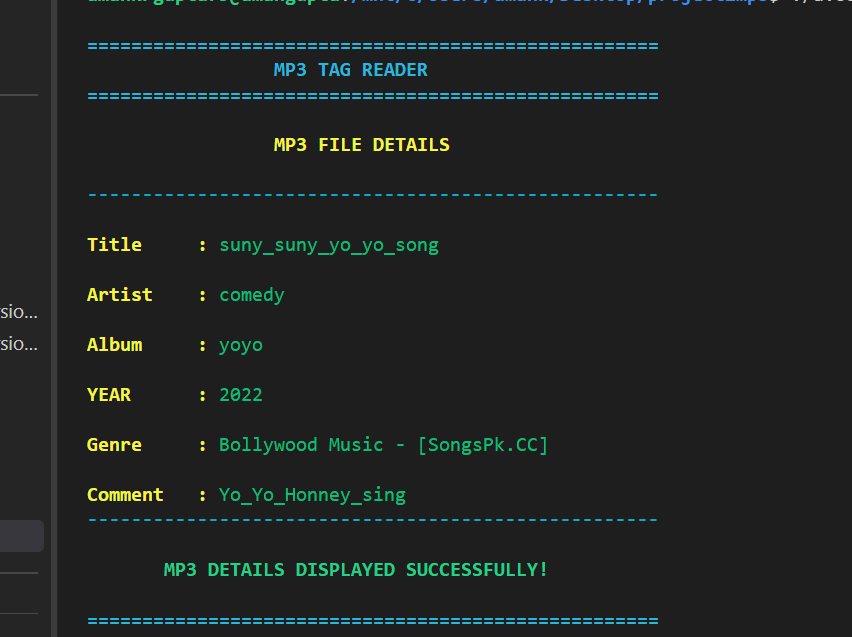
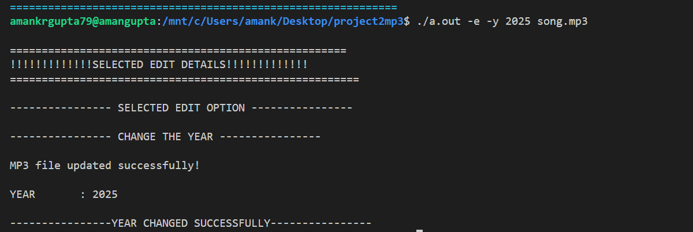
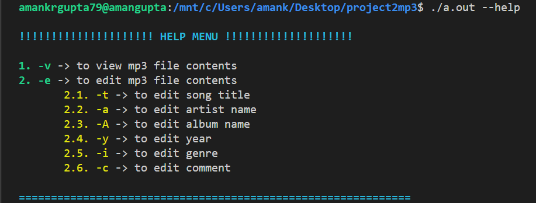
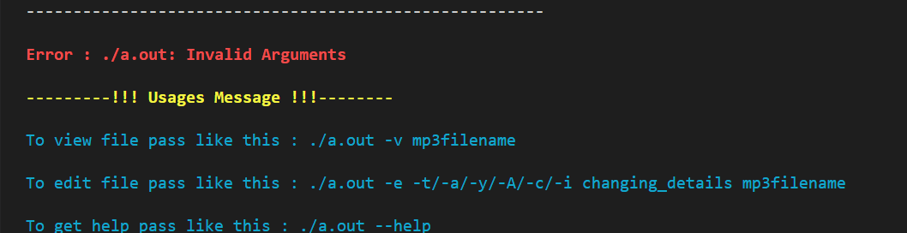

# MP3 Tag Reader and Editor

## Project Overview
MP3 Tag Reader is a command-line-based application developed using C programming. It allows users to read and edit metadata information stored in MP3 files using command-line arguments.

## Features
- View MP3 metadata.
- Edit song title.
- Edit artist name.
- Edit album name.
- Edit year.
- Edit genre.
- Edit comments.
- Help menu with command instructions.
- Temporary file handling for metadata editing.
- Colored terminal output.

## Technologies Used
- Programming Language: C
- File Handling: Binary File I/O
- Concepts: Structures, Pointers, String Handling, Command Line Arguments
- Tools: GCC, Linux Terminal, Git and GitHub

## Project Structure
- `main.c` – Handles command-line arguments.
- `view.c` – Reads MP3 metadata.
- `edit.c` – Edits MP3 metadata.
- `help.c` – Displays the help menu.
- `header.h` – Contains function declarations and macros.

## Compilation

gcc main.c help.c view.c edit.c -o mp3tag

## Usage

View MP3 details:

./mp3tag -v song.mp3

Edit song title:

./mp3tag -e -t "New Title" song.mp3

Edit artist:

./mp3tag -e -a "New Artist" song.mp3

Edit album:

./mp3tag -e -A "New Album" song.mp3

Edit year:

./mp3tag -e -y 2025 song.mp3

Edit genre:

./mp3tag -e -i "Rock" song.mp3

Display help:

./mp3tag --help

## Project Screenshots

### 1. View MP3 Details

### 2. Edit MP3 Details

### 3. Help Menu

### 4. Usage Menu

## Future Improvements

The following features can be added to improve the project:

1. **Graphical User Interface (GUI):** Develop a user-friendly interface instead of relying only on command-line operations.
2. **Multiple Audio Format Support:** Extend support to formats such as WAV, FLAC, and other audio formats.
3. **Album Artwork Management:** Add functionality to view, extract, and update embedded album covers.
4. **Multiple File Editing:** Allow users to edit metadata of multiple MP3 files at once.
5. **Advanced ID3 Support:** Support additional ID3 frames and different text encoding formats.
6. **Metadata Validation:** Add validation to prevent invalid or corrupted metadata.
7. **Search and Filter:** Allow users to search songs by title, artist, album, or genre.
8. **Backup and Restore:** Create backups before modifying original MP3 files.
9. **Cross-Platform Compatibility:** Improve support for Windows, Linux, and macOS.

### Practical Example

Suppose a user has downloaded an MP3 song with an incorrect title or artist name. Using this application, the user can view the existing metadata and update the song title, artist, album, year, genre, or comment through command-line arguments.

## Conclusion

The MP3 Tag Reader project demonstrates how C programming can be used to read, analyze, and modify metadata stored in MP3 files. It provides practical experience with binary file handling, command-line arguments, pointers, and string manipulation.

This project helped develop a better understanding of file structures and real-world file processing operations. It can be extended into a complete music library management application with advanced metadata editing and audio file organization features.

## Author
Aman Kumar Gupta
